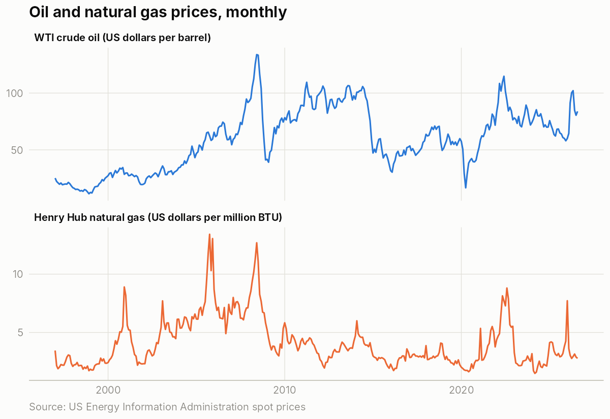
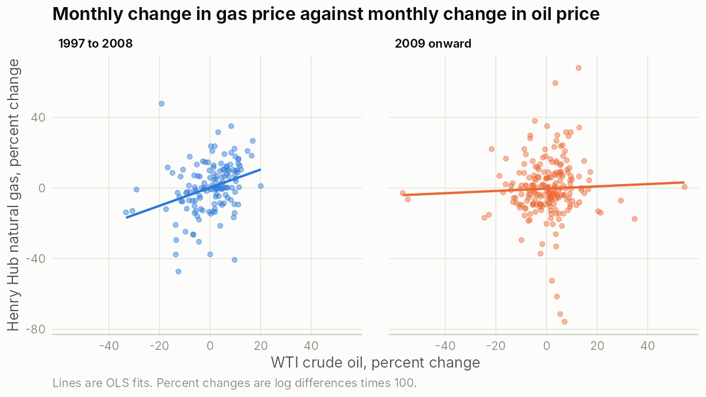
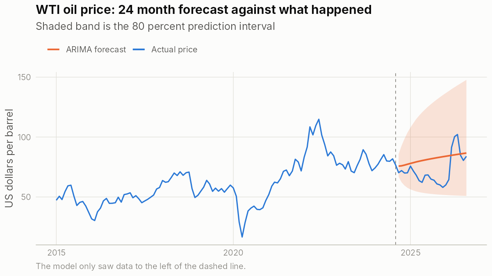

# Energy prices: regression and forecasting

## About this project

In my econometrics course at Western University I completed a capstone project that used OLS regression and time series forecasting on energy commodity markets. The original files were lost. This project is a new version of that kind of analysis, built in 2026 with public data. The code and every number below were produced fresh and can be rerun by anyone.

## Questions

1. How closely does the US natural gas price follow the oil price?
2. Did that link change after 2008?
3. Can a time series model forecast the oil price better than simply assuming next month equals this month?

## Data

* WTI crude oil spot price, US dollars per barrel, monthly
* Henry Hub natural gas spot price, US dollars per million BTU, monthly
* 356 months, January 1997 to August 2026

Both series come from the US Energy Information Administration (EIA). I used the copies published by the open data project at [github.com/datasets](https://github.com/datasets) (`oil-prices` and `natural-gas`), which are released under the Open Data Commons Public Domain Dedication and License.



## Method

**Step 1. Check whether the prices wander.** A regression between two prices that both drift over time can show a strong link that is not real. The Augmented Dickey Fuller test checks for this. The oil price in levels behaves like a wandering series (p value 0.41). The gas price is a borderline case (p value 0.06). The monthly percentage changes of both are stable (p value 0.01 or lower).

**Step 2. Regression in levels (Model 1).** Log gas price on log oil price. The slope is 0.30 and R squared is 0.13, but the Durbin Watson statistic is 0.14, far below 2. The errors are strongly correlated from month to month, so the usual standard errors cannot be trusted. A Phillips Ouliaris test gives some evidence of a long run link between the two prices (p value 0.03).

**Step 3. Regression in monthly changes (Models 2 to 4).** Percentage change in gas on percentage change in oil, with Newey West standard errors, which stay valid when errors are correlated or uneven. Model 3 adds an interaction term so the slope can differ from January 2009 onward. Model 4 adds month of year dummies to control for the seasonal pattern in gas prices.

**Step 4. Forecasting.** Three models forecast the oil price one month ahead, refit every month over the last 60 months: a random walk (next month equals this month), ARIMA, and exponential smoothing (ETS). The models never see the month they are forecasting.

## Results

**The link between oil and gas is weak, and it weakened after 2008.**

* Over the full sample, a 1 percent rise in oil goes with a 0.21 percent rise in gas in the same month (Newey West standard error 0.09, p value 0.015). Oil explains under 2 percent of the monthly movement in gas.
* From 1997 to 2008 the slope is 0.51 (standard error 0.15, p value below 0.001).
* From 2009 onward the slope falls by 0.45 (standard error 0.17, p value 0.007), which leaves it close to zero at about 0.06.
* The result holds with month of year dummies: the fall in slope is 0.51 (p value 0.002).



**The ARIMA model does not clearly beat the simplest forecast.**

Average error over 60 one month ahead forecasts, in US dollars per barrel:

* Random walk: RMSE 7.10, MAE 5.42
* ARIMA: RMSE 6.91, MAE 5.25
* ETS: RMSE 7.10, MAE 5.42

ARIMA is about 3 percent more accurate than the random walk, but a Diebold Mariano test finds the difference is not statistically significant (p value 0.44). The 24 month forecast below shows why: the 80 percent prediction interval is very wide.



## Limits

* The 2009 break date is my choice, based on the rise of US shale gas production around that time. It was not estimated from the data, and a different date would give somewhat different numbers.
* The regressions show how the prices move together. They do not show that oil prices cause gas prices.
* Monthly averages hide movements within the month.
* Forecast accuracy is measured on one 60 month window. Another window could rank the models differently.

## How to run

R 4.3 or later with the packages `forecast`, `lmtest`, `sandwich`, `tseries` and `ggplot2`. From this folder:

```
Rscript code/01_prepare_data.R
Rscript code/02_ols_regression.R
Rscript code/03_forecasting.R
```

Full output is saved in the `output` folder: `regression_results.txt`, `regression_table.csv`, `forecast_results.txt` and `forecast_accuracy.csv`.
