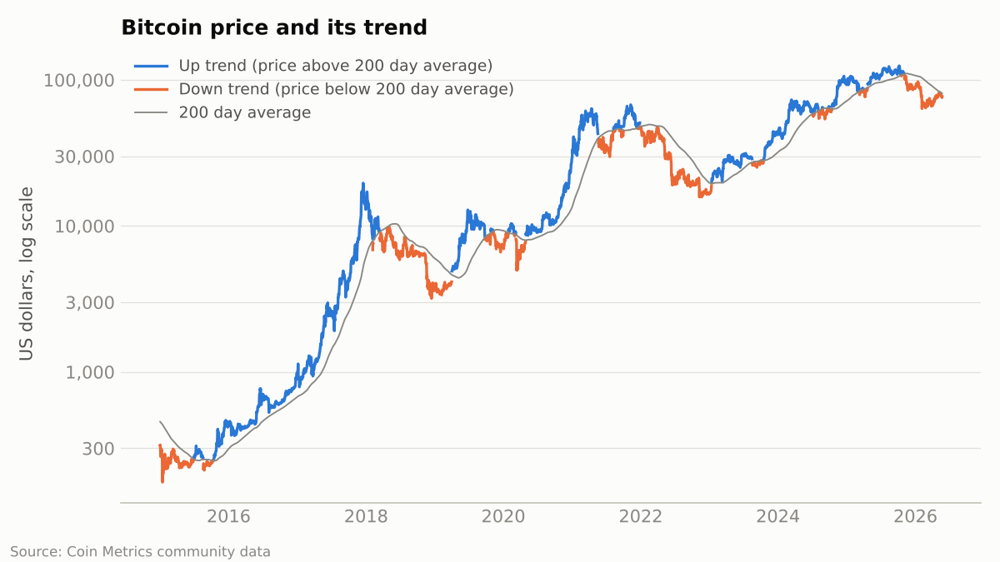
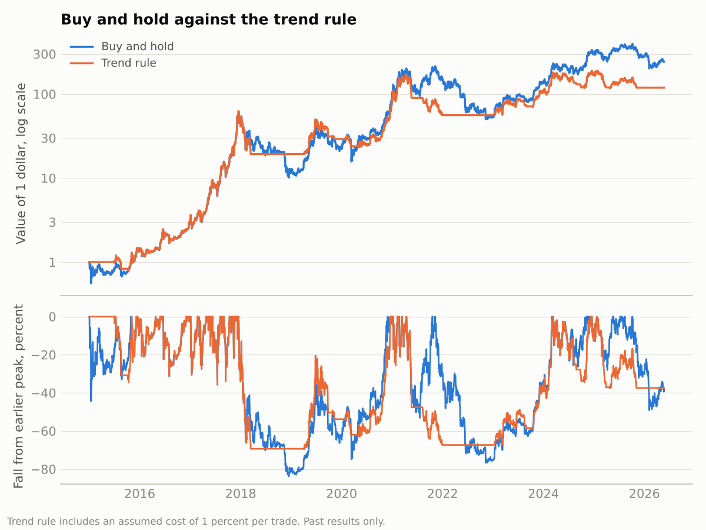

# Does timing matter when buying Bitcoin?

## About this project

A common question for new investors is whether there is a sensible way to decide when to buy, or whether trying to time the market is a mistake. This project tests two common ideas on past prices.

**This is a study of past data. It is not investment advice, and it does not predict future prices.**

## Questions

1. Is a simple signal of "up trend" or "down trend" useful?
2. Would holding Bitcoin only during up trends have beaten simply holding it?
3. Is it better to invest a sum all at once, or to spread it over 12 monthly amounts?

## Data

Daily Bitcoin price in US dollars from Coin Metrics community data ([github.com/coinmetrics/data](https://github.com/coinmetrics/data)), shared under the Creative Commons Attribution NonCommercial 4.0 licence. The study period is 1 January 2015 to 23 May 2026 (4,161 days).

## Method

**Trend signal.** The price is in an up trend when it is above its average over the previous 200 days, and in a down trend when it is below. The 200 day average is a common convention. I chose it before looking at the results.

**Trend rule.** Hold Bitcoin on days after an up trend signal, and hold cash on days after a down trend signal. The rule acts one day after the signal, so it never uses information it would not have had. Each buy or sell costs an assumed 1 percent.

**All at once or monthly.** For every possible starting month, compare 1,200 dollars invested on the first day with 100 dollars invested at the start of each of 12 months, both valued at the end of the 12 months.



## Results

**The trend signal carries real information.** In the 90 days after an up trend day, the price rose 66 percent of the time, with a median gain of 16.1 percent. After a down trend day it rose 51 percent of the time, with a median gain of 1.0 percent.

**But trading on it did not beat simply holding.**

* Buy and hold: 1 dollar grew to 243 dollars (62.0 percent per year). The worst fall from a peak was 83.8 percent.
* Trend rule: 1 dollar grew to 119 dollars (52.1 percent per year). The worst fall from a peak was 69.6 percent. The rule was invested 61 percent of the time and made 70 trades.

The rule gave up about half of the final value in exchange for a smaller worst fall. It was late to sell and late to buy back, and each false signal cost money.



**The result depends heavily on the window chosen.** Final value of 1 dollar with other averages:

* 50 days: 77 dollars
* 100 days: 87 dollars
* 150 days: 249 dollars
* 200 days: 119 dollars
* 250 days: 110 dollars

Only one window matched buy and hold. When a small change in a setting changes the result this much, the rule is not reliable. Picking the 150 day window after seeing this table would be fitting the rule to the past.

**Investing all at once usually ended higher, with more risk.** Across 125 starting months, investing all at once finished ahead in 91 (73 percent). The median result was 2,086 dollars against 1,749 dollars for monthly amounts. The worst case was the reverse: 339 dollars for all at once against 543 dollars for monthly amounts.

## What I take from this

* A trend signal describes the past well but did not make money as a trading rule after costs.
* Spreading purchases over time lowered the worst outcome and also lowered the typical outcome. That is a trade between risk and return, not a free gain.
* Over this period nothing tested here reliably beat buying and holding.

## Limits

* One asset over one period in which the price rose enormously. The same tests on a different period could look very different.
* The 90 day windows overlap, so the days are not independent observations and the percentages are less certain than the large day counts suggest.
* The 1 percent trading cost is an assumption. Real costs vary by platform.
* Cash is assumed to earn nothing. Taxes are ignored.
* The monthly plan holds part of the money in cash for most of the year, so part of the difference comes from being less invested.

## How to run

Python 3 with `pandas`, `numpy` and `matplotlib`. From this folder:

```
python3 code/bitcoin_timing.py
```

Output is saved in the `output` folder: `results.txt`, `window_comparison.csv` and two figures.
